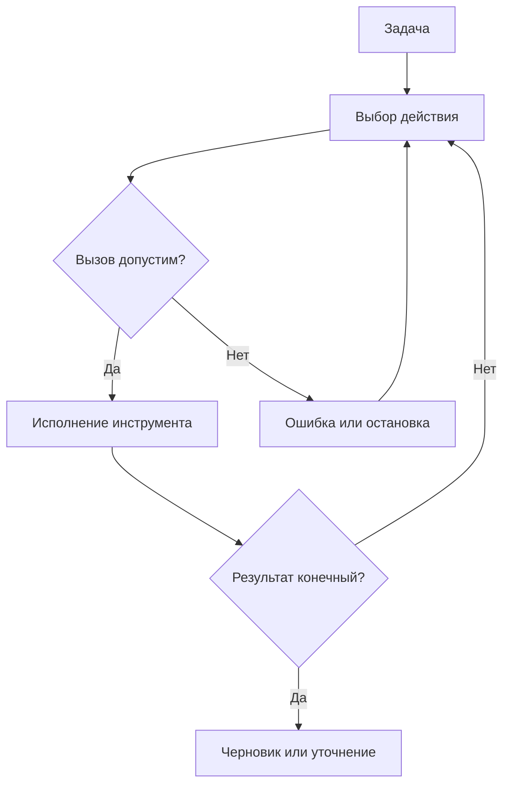

# Лекция 1. Как устроен агент — 45 минут

[Маршрут занятия](../README.md) · [Следующая лекция](02_tools.md)

## 1. От ответа к действию — 3 минуты

Представьте сотрудника сервис-деска. Ему приходит сообщение: «Как установить редактор?» Ответить красивым текстом недостаточно: нужно найти действующее правило и не перепутать срок первого ответа со сроком установки. Если данных нет, полезнее задать вопрос, чем придумать ответ.

ИИ-агент в рамках этого занятия — программа, в которой языковая модель выбирает следующие действия по задаче и результатам предыдущих действий. Модель не становится операционной системой и не исполняет Python силой текста. Приложение предоставляет ей ограниченный набор функций.

Вопрос группе: «Что должно произойти в реальной системе, чтобы фразу “заявка создана” можно было считать правдой?» Ответ: запись должна появиться в целевой системе; текст модели сам по себе этого не подтверждает.

## 2. Чат, workflow, агент — 5 минут

| Подход | Кто определяет порядок | Пример |
|---|---|---|
| Чат с моделью | Пользователь направляет диалог; модель отвечает | Объяснить правило |
| Workflow | Код задаёт порядок и ветвления | Проверить поля → найти запись → составить ответ |
| LLM-агент | Модель выбирает действие в пределах разрешённых функций | Поиск → оценка результата → другой инструмент или уточнение |

Чат — также форма интерфейса. Внутри чата может работать агент, а агент может запускаться без чата по расписанию. Workflow тоже может включать вызов LLM, например для классификации. Различие здесь — в том, кто управляет следующими шагами.

В нашем `sim` работают заранее заданные правила. Это тренажёр цикла, а не доказательство интеллектуального поведения. В `llm` решения принимает модель; инструменты и проверки остаются теми же.

## 3. Когда достаточно обычного кода — 4 минуты

Расчёт `цена × количество` имеет точные правила. Передача арифметики модели добавляет стоимость и неопределённость без явной пользы. Поэтому агент вызывает инструмент расчёта, а не угадывает сумму.

Если порядок действий стабилен, сначала рассмотрите обычный процесс. Агент имеет смысл, когда поступают разные задачи, нужна адаптация к промежуточным результатам и допустимые действия можно ограничить и проверить.

Мини-дискуссия: нужна ли LLM для трёх фиксированных вызовов? Для нашего узкого кейса обычно нет. Это сознательно небольшой учебный стенд; его цель — сделать механизмы видимыми, а не доказать коммерческую необходимость агента.

## 4. Цикл и его участники — 5 минут



У цикла есть бюджет шагов и времени: стрелка обратно не означает бесконечное выполнение. В `run()` состояние принадлежит приложению. `choose()` получает снимок состояния, возвращает имя и аргументы инструмента. `Toolkit.execute()` проверяет вызов и исполняет его. `observe()` передаёт результат обратно политике выбора.

Аналогия — диспетчер и исполнители. Диспетчер выбирает поручение, но исполнитель проверяет, можно ли его выполнить. Аналогия ограничена: модель может ошибаться даже в простом выборе, поэтому полномочия нельзя определять её словами.

## 5. Контракт инструмента — 4 минуты

Для `get_sla` контракт включает имя, назначение, аргумент `priority`, допустимые значения и результат с часами и источником. Неизвестный приоритет — ошибка. Подстановка `urgent` вместо исходного `normal` — тоже ошибка, хотя это допустимая строка.

```python
Action("get_sla", {"priority": "normal"})
```

Контракт нужен одновременно модели, исполнителю и тестам. Описание помогает модели выбрать функцию, но программная проверка всё равно обязательна. `strict` в схеме API помогает соблюдать форму, а не доказывает смысловую корректность.

## 6. Состояние задачи — 4 минуты

Состояние отвечает на вопросы: что найдено, какие сведения проверены, что ещё отсутствует? В нашем примере `matches` — найденные регламенты, `sla` — полученный срок, `quote` — расчёт стоимости, если подключено упражнение.

История сообщений модели и состояние приложения — разные вещи. История сообщает модели, что происходило. Состояние исполнителя определяет, разрешена ли подготовка черновика. Нельзя заменить состояние фразой модели «я уже проверил регламент».

Две заявки получают разные экземпляры состояния. Снимки передаются через `deepcopy`: изменение словаря внутри политики не меняет проверенные данные исполнителя. Это защита от случайных изменений, не песочница для вредоносного Python-кода.

## 7. Поиск и источники — 4 минуты

`search_policy` разбивает вопрос на слова и сравнивает начала слов с учебными ключами. «Установить» подходит к `установ`; «доступ» приводит к другому регламенту. Найденный документ не обязательно верен для реальной ситуации, а отсутствие совпадений не означает отсутствие правила в мире.

Retrieval — получение подходящих данных. RAG обычно добавляет найденные материалы в контекст генерации. Наш поиск — только упрощённая часть такого подхода; эмбеддингов и векторной базы здесь нет.

Вопрос: «Что произойдёт с запросом “Не нужно устанавливать ПО, нужна справка”?» Ключевые слова могут дать несколько результатов, поскольку поиск не понимает отрицание. Учащийся должен обнаружить это ограничение, а не считать библиотечный поиск интеллектуальным.

## 8. Живой запуск — 5 минут

```bash
python -m agent_lab --case normal
python -m agent_lab --case access
python -m agent_lab --case ambiguous
```

До запуска попросите предсказать источник. В первом случае — `IT-01`, во втором — `IT-02`. В третьем найдены оба правила, поэтому симулятор задаёт вопрос. Покажите, что поле `question` влияет на поиск, а `priority` — на SLA.

Затем откройте [фиксированный процесс](../examples/workflow.py). Он подходит для известного обычного случая. Сравните его с циклом: фиксированная последовательность проще, но не предлагает маршрут для неоднозначности. Её можно расширить обычными условиями — это честная альтернатива агенту.

## 9. Польза и цена — 3 минуты

Условный пример: 100 обращений, на каждом удалось сэкономить 5 минут, но проверка и сопровождение заняли 60 минут. Чистая экономия — 440 минут. Эти числа не измерение проекта; реальную пользу оценивают на пилоте.

Кроме времени измеряйте долю корректных источников, необоснованных ответов, уточнений, передач человеку, вызовов модели и затраченных токенов. Низкое число уточнений не обязательно хорошо: агент может уверенно отвечать на неоднозначные вопросы.

## 10. Проверка понимания — 3 минуты

Попросите каждого коротко ответить: кто выбирает действие в `sim` и `llm`? Кто исполняет Python? Чем подтверждается результат? Почему наш расчёт стоимости выполняет функция?

Ожидаемые ответы: условия или модель; приложение; результат инструмента и проверяемое состояние; арифметика имеет точные правила.

## 11. Выбор собственного кейса — 3 минуты

Каждая команда предлагает одну небольшую задачу: например, подобрать инструкцию по учебной заявке. Укажите вход, результат, доступные инструменты и ситуацию, в которой нужно остановиться. Не выбирайте задачу «автоматизировать весь отдел» — у неё нет проверяемого конца в рамках практики.

## 12. Переход к надёжности — 2 минуты

Главная мысль: поведение системы определяется не только моделью, но и кодом, данными, инструментами и правилами остановки. Во второй лекции проверим, что происходит при ошибочном выборе действия.

Источники и дополнительное чтение: [аннотированный список](../literature/README.md). Терминологическое разграничение workflow/agent используется как рабочая модель курса, а не единственное определение агента во всех областях ИИ.
